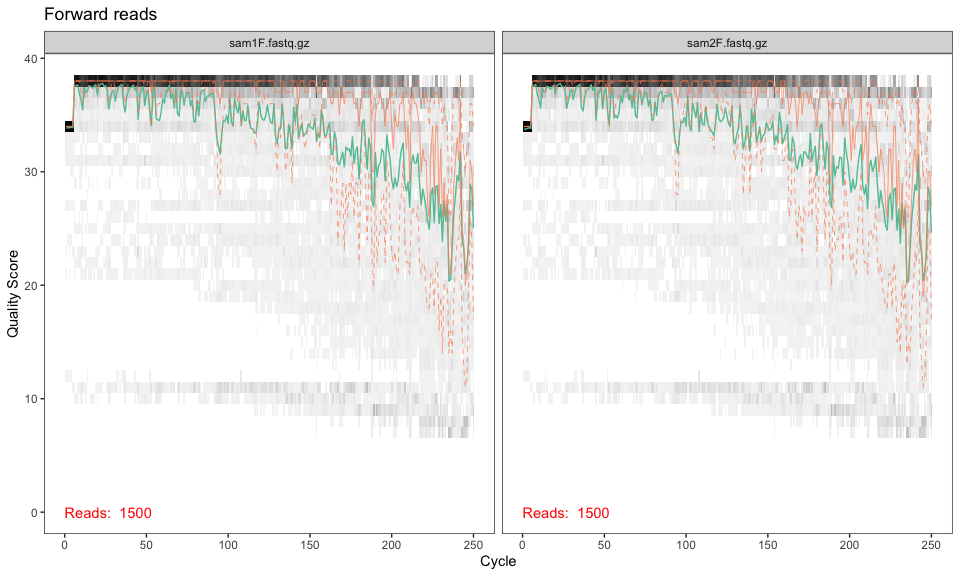
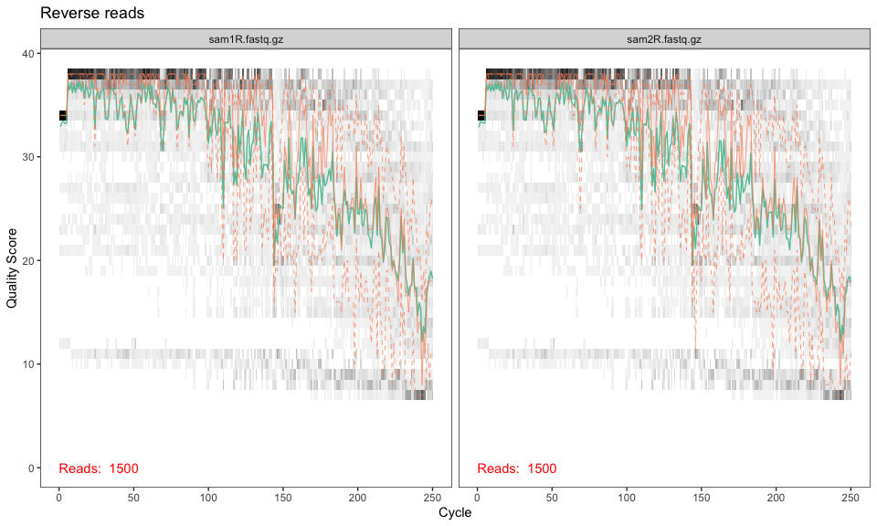
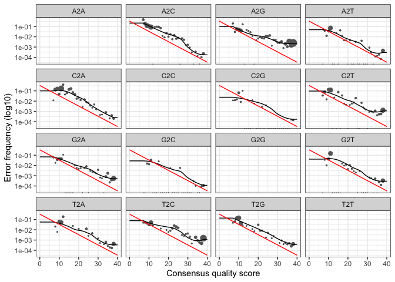
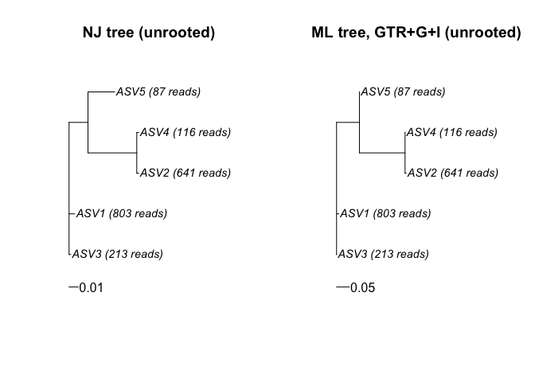

IBS7048 Midterm Problem 4 - DADA2
================
hjji-BAGEL
2026-10-25

``` r
# Load the packages used in class
library(dada2)
```

    ## Loading required package: Rcpp

``` r
packageVersion("dada2")
```

    ## [1] '1.38.0'

``` r
# Folder for all outputs of Problem 4 (filtered reads, figures, tables, tree)
out_dir <- "P4_output"
dir.create(out_dir, showWarnings = FALSE)
```

# 4a. ASV table from sam1 and sam2

## Input files (given in the exam)

``` r
rawpath <- system.file("extdata", package = "dada2")
fnFs <- file.path(rawpath, c("sam1F.fastq.gz", "sam2F.fastq.gz"))
fnRs <- file.path(rawpath, c("sam1R.fastq.gz", "sam2R.fastq.gz"))
sample.names <- c("sam1", "sam2")

# Check that the four files exist
file.exists(c(fnFs, fnRs))
```

    ## [1] TRUE TRUE TRUE TRUE

## Quality profiles

``` r
# Quality score along the read position for forward and reverse reads
p_F <- plotQualityProfile(fnFs) + ggplot2::ggtitle("Forward reads")
p_R <- plotQualityProfile(fnRs) + ggplot2::ggtitle("Reverse reads")
p_F
```

<!-- -->

``` r
p_R
```

<!-- -->

``` r
# Save the plots as PNG files for the answer sheet
ggplot2::ggsave(file.path(out_dir, "4a_quality_forward.png"), p_F, width = 8, height = 5, dpi = 300)
ggplot2::ggsave(file.path(out_dir, "4a_quality_reverse.png"), p_R, width = 8, height = 5, dpi = 300)
```

## Filter and trim

``` r
# Output paths for the filtered reads
filtFs <- file.path(out_dir, "filtered", paste0(sample.names, "_F_filt.fastq.gz"))
filtRs <- file.path(out_dir, "filtered", paste0(sample.names, "_R_filt.fastq.gz"))
names(filtFs) <- sample.names
names(filtRs) <- sample.names

# Cut forward reads at 230 bp and reverse reads at 160 bp,
# then discard reads with more than 2 expected errors (maxEE)
# multithread = FALSE because multithreading does not work on Windows
out <- filterAndTrim(fnFs, filtFs, fnRs, filtRs,
                     truncLen = c(230, 160), maxEE = c(2, 2),
                     compress = TRUE, multithread = FALSE)
```

    ## Creating output directory: P4_output/filtered

``` r
out
```

    ##                reads.in reads.out
    ## sam1F.fastq.gz     1500      1063
    ## sam2F.fastq.gz     1500      1060

## Error model and denoising

``` r
# Learn the error rates from the filtered reads
errF <- learnErrors(filtFs, multithread = FALSE)
```

    ## 488290 total bases in 2123 reads from 2 samples will be used for learning the error rates.

``` r
errR <- learnErrors(filtRs, multithread = FALSE)
```

    ## 339680 total bases in 2123 reads from 2 samples will be used for learning the error rates.

``` r
# Check the fit of the error model (points = observed, line = fitted)
plotErrors(errF, nominalQ = TRUE)
```

    ## Warning in scale_y_log10(): log-10 transformation introduced infinite values.

    ## Warning: Removed 164 rows containing missing values or values outside the scale range
    ## (`geom_line()`).
    ## Removed 164 rows containing missing values or values outside the scale range
    ## (`geom_line()`).

<!-- -->

``` r
# Infer the true sequences (ASVs) in each sample using the error model
dadaFs <- dada(filtFs, err = errF, multithread = FALSE)
```

    ## Sample 1 - 1063 reads in 413 unique sequences.
    ## Sample 2 - 1060 reads in 416 unique sequences.

``` r
dadaRs <- dada(filtRs, err = errR, multithread = FALSE)
```

    ## Sample 1 - 1063 reads in 440 unique sequences.
    ## Sample 2 - 1060 reads in 430 unique sequences.

## Merge, sequence table, chimera removal

``` r
# Merge forward and reverse reads that overlap (default minOverlap = 12)
mergers <- mergePairs(dadaFs, filtFs, dadaRs, filtRs, verbose = TRUE)
```

    ## 1046 paired-reads (in 8 unique pairings) successfully merged out of 1059 (in 13 pairings) input.

    ## 959 paired-reads (in 8 unique pairings) successfully merged out of 1055 (in 14 pairings) input.

``` r
# Sample x ASV count table
seqtab <- makeSequenceTable(mergers)
dim(seqtab)
```

    ## [1] 2 9

``` r
# Remove chimeras (sequences made of two more abundant parent sequences)
seqtab.nochim <- removeBimeraDenovo(seqtab, method = "consensus",
                                    multithread = FALSE, verbose = TRUE)
```

    ## Identified 0 bimeras out of 9 input sequences.

``` r
dim(seqtab.nochim)
```

    ## [1] 2 9

## Read tracking table

``` r
# Number of reads that remain after each step
getN <- function(x) sum(getUniques(x))
track <- cbind(out,
               sapply(dadaFs, getN), sapply(dadaRs, getN),
               sapply(mergers, getN), rowSums(seqtab.nochim))
colnames(track) <- c("input", "filtered", "denoisedF", "denoisedR", "merged", "nonchim")
rownames(track) <- sample.names
track
```

    ##      input filtered denoisedF denoisedR merged nonchim
    ## sam1  1500     1063      1061      1061   1046    1046
    ## sam2  1500     1060      1056      1057    959     959

``` r
# Percentage of input reads that remain after each step
round(100 * track / track[, "input"], 1)
```

    ##      input filtered denoisedF denoisedR merged nonchim
    ## sam1   100     70.9      70.7      70.7   69.7    69.7
    ## sam2   100     70.7      70.4      70.5   63.9    63.9

``` r
# Reads lost at each step (both samples combined)
tot <- colSums(track)
loss <- c(filtering = tot[["input"]] - tot[["filtered"]],
          denoising = tot[["filtered"]] - tot[["denoisedF"]],
          merging   = tot[["denoisedF"]] - tot[["merged"]],
          chimera   = tot[["merged"]] - tot[["nonchim"]])
loss
```

    ## filtering denoising   merging   chimera 
    ##       877         6       112         0

``` r
round(100 * loss / tot[["input"]], 1)   # as % of all input reads
```

    ## filtering denoising   merging   chimera 
    ##      29.2       0.2       3.7       0.0

``` r
# Answers for 4a
n_ASV <- ncol(seqtab.nochim)                       # number of ASVs after chimera removal
chimera_reads <- sum(seqtab) - sum(seqtab.nochim)  # reads removed as chimeras
chimera_ASVs <- ncol(seqtab) - ncol(seqtab.nochim) # sequences flagged as chimeras
c(ASVs = n_ASV, chimera_reads = chimera_reads, chimera_ASVs = chimera_ASVs)
```

    ##          ASVs chimera_reads  chimera_ASVs 
    ##             9             0             0

``` r
write.csv(track, file.path(out_dir, "4a_track_reads.csv"))
```

## Verification

``` r
# 1) Reads never increase from one step to the next (denoisedR checked from filtered)
all(track[, "input"] >= track[, "filtered"],
    track[, "filtered"] >= track[, "denoisedF"],
    track[, "filtered"] >= track[, "denoisedR"],
    track[, "denoisedF"] >= track[, "merged"],
    track[, "merged"] >= track[, "nonchim"])
```

    ## [1] TRUE

``` r
# 2) The last column of the table equals the final ASV table
all(track[, "nonchim"] == rowSums(seqtab.nochim))
```

    ## [1] TRUE

``` r
# 3) Chimera reads = merged reads - non-chimeric reads
chimera_reads == sum(track[, "merged"]) - sum(track[, "nonchim"])
```

    ## [1] TRUE

``` r
# 4) ASV lengths should be close to the expected amplicon length (252-253 bp)
table(nchar(getSequences(seqtab.nochim)))
```

    ## 
    ## 252 253 
    ##   1   8

# 4b. truncLen = c(120,120)

## Re-run with truncLen = c(120,120) and compare with 4a

``` r
# Same pipeline as 4a; only truncLen is changed to c(120, 120)
filtFs_120 <- file.path(out_dir, "filtered_120", paste0(sample.names, "_F_filt.fastq.gz"))
filtRs_120 <- file.path(out_dir, "filtered_120", paste0(sample.names, "_R_filt.fastq.gz"))
names(filtFs_120) <- sample.names
names(filtRs_120) <- sample.names

out_120 <- filterAndTrim(fnFs, filtFs_120, fnRs, filtRs_120,
                         truncLen = c(120, 120), maxEE = c(2, 2),
                         compress = TRUE, multithread = FALSE)
```

    ## Creating output directory: P4_output/filtered_120

``` r
errF_120 <- learnErrors(filtFs_120, multithread = FALSE)
```

    ## 340080 total bases in 2834 reads from 2 samples will be used for learning the error rates.

``` r
errR_120 <- learnErrors(filtRs_120, multithread = FALSE)
```

    ## 340080 total bases in 2834 reads from 2 samples will be used for learning the error rates.

``` r
dadaFs_120 <- dada(filtFs_120, err = errF_120, multithread = FALSE)
```

    ## Sample 1 - 1418 reads in 387 unique sequences.
    ## Sample 2 - 1416 reads in 365 unique sequences.

``` r
dadaRs_120 <- dada(filtRs_120, err = errR_120, multithread = FALSE)
```

    ## Sample 1 - 1418 reads in 505 unique sequences.
    ## Sample 2 - 1416 reads in 488 unique sequences.

``` r
# Try to merge the 120 bp forward and reverse reads (same default minOverlap = 12)
mergers_120 <- mergePairs(dadaFs_120, filtFs_120, dadaRs_120, filtRs_120, verbose = TRUE)
```

    ## 0 paired-reads (in 0 unique pairings) successfully merged out of 1394 (in 19 pairings) input.

    ## 0 paired-reads (in 0 unique pairings) successfully merged out of 1404 (in 19 pairings) input.

``` r
# Side-by-side comparison of 4a and 4b (reads after filtering, denoising, merging)
compare <- data.frame(
  sample              = sample.names,
  filtered_230_160    = out[, "reads.out"],
  filtered_120_120    = out_120[, "reads.out"],
  denoisedF_230_160   = sapply(dadaFs, getN),
  denoisedF_120_120   = sapply(dadaFs_120, getN),
  merged_230_160      = sapply(mergers, getN),
  merged_120_120      = sapply(mergers_120, getN),
  row.names           = NULL
)
compare
```

    ##   sample filtered_230_160 filtered_120_120 denoisedF_230_160 denoisedF_120_120
    ## 1   sam1             1063             1418              1061              1394
    ## 2   sam2             1060             1416              1056              1404
    ##   merged_230_160 merged_120_120
    ## 1           1046              0
    ## 2            959              0

``` r
write.csv(compare, file.path(out_dir, "4b_merge_comparison.csv"), row.names = FALSE)
```

## Verification: overlap length

``` r
# Overlap = forward length + reverse length - amplicon length (252-253 bp)
amplicon <- c(252, 253)
overlap <- rbind("truncLen c(230,160)" = 230 + 160 - amplicon,
                 "truncLen c(120,120)" = 120 + 120 - amplicon)
colnames(overlap) <- paste0("amplicon_", amplicon, "bp")
overlap
```

    ##                     amplicon_252bp amplicon_253bp
    ## truncLen c(230,160)            138            137
    ## truncLen c(120,120)            -12            -13

``` r
# A merge needs at least minOverlap = 12 bp of overlap
overlap >= 12
```

    ##                     amplicon_252bp amplicon_253bp
    ## truncLen c(230,160)           TRUE           TRUE
    ## truncLen c(120,120)          FALSE          FALSE

``` r
# No reads were merged with truncLen = c(120,120)
sum(sapply(mergers_120, getN)) == 0
```

    ## [1] TRUE

# 4c. Phylogenetic tree of the top 5 ASVs

## Select the top 5 ASVs and name them ASV1 to ASV5

``` r
library(DECIPHER)
```

    ## Loading required package: Biostrings

    ## Loading required package: BiocGenerics

    ## Loading required package: generics

    ## 
    ## Attaching package: 'generics'

    ## The following objects are masked from 'package:base':
    ## 
    ##     as.difftime, as.factor, as.ordered, intersect, is.element, setdiff,
    ##     setequal, union

    ## 
    ## Attaching package: 'BiocGenerics'

    ## The following objects are masked from 'package:stats':
    ## 
    ##     IQR, mad, sd, var, xtabs

    ## The following objects are masked from 'package:base':
    ## 
    ##     anyDuplicated, aperm, append, as.data.frame, basename, cbind,
    ##     colnames, dirname, do.call, duplicated, eval, evalq, Filter, Find,
    ##     get, grep, grepl, is.unsorted, lapply, Map, mapply, match, mget,
    ##     order, paste, pmax, pmax.int, pmin, pmin.int, Position, rank,
    ##     rbind, Reduce, rownames, sapply, saveRDS, table, tapply, unique,
    ##     unsplit, which.max, which.min

    ## Loading required package: S4Vectors

    ## Warning: package 'S4Vectors' was built under R version 4.5.3

    ## Loading required package: stats4

    ## 
    ## Attaching package: 'S4Vectors'

    ## The following object is masked from 'package:utils':
    ## 
    ##     findMatches

    ## The following objects are masked from 'package:base':
    ## 
    ##     expand.grid, I, unname

    ## Loading required package: IRanges

    ## Loading required package: XVector

    ## Loading required package: Seqinfo

    ## 
    ## Attaching package: 'Biostrings'

    ## The following object is masked from 'package:base':
    ## 
    ##     strsplit

``` r
library(phangorn)
```

    ## Loading required package: ape

    ## 
    ## Attaching package: 'ape'

    ## The following object is masked from 'package:Biostrings':
    ## 
    ##     complement

``` r
# Total reads of each ASV across both samples (after chimera removal)
asv_counts <- colSums(seqtab.nochim)

# Five ASVs with the highest total reads, in decreasing order of abundance
top5_seqs   <- names(sort(asv_counts, decreasing = TRUE))[1:5]
top5_counts <- asv_counts[top5_seqs]

# Name them ASV1 to ASV5 (ASV1 = most abundant)
top5 <- data.frame(ASV = paste0("ASV", 1:5),
                   total_reads = as.vector(top5_counts),
                   length_bp = nchar(top5_seqs),
                   sequence = top5_seqs)
top5[, c("ASV", "total_reads", "length_bp")]
```

    ##    ASV total_reads length_bp
    ## 1 ASV1         803       253
    ## 2 ASV2         641       253
    ## 3 ASV3         213       253
    ## 4 ASV4         116       253
    ## 5 ASV5          87       253

``` r
write.csv(top5, file.path(out_dir, "4c_top5_ASVs.csv"), row.names = FALSE)
```

## Alignment (DECIPHER) and trees (phangorn), following the lecture code

``` r
# DNAStringSet with ASV names as sequence names
seqs <- Biostrings::DNAStringSet(top5_seqs)
names(seqs) <- top5$ASV

# Multiple sequence alignment with DECIPHER (anchor = NA as in the lecture code)
alignment <- AlignSeqs(seqs, anchor = NA, verbose = FALSE)
alignment
```

    ## DNAStringSet object of length 5:
    ##     width seq                                               names               
    ## [1]   253 TACGGAGGATCCGAGCGTTATCC...CGAAAGTGTGGGTATCAAACAGG ASV1
    ## [2]   253 TACGGAGGATCCGAGCGTTATCC...CGAAAGTGTGGGTATCAAACAGG ASV2
    ## [3]   253 TACGGAGGATCCGAGCGTTATCC...CGAAAGTGTGGGTATCAAACAGG ASV3
    ## [4]   253 TACGGAGGATCCGAGCGTTATCC...CGAAAGTGTGGGTATCAAACAGG ASV4
    ## [5]   253 TACGGAGGATCCGAGCGTTATCC...CGAAAGTGTGGGTATCAAACAGG ASV5

``` r
# Convert the alignment to a phangorn object
phang_align <- phyDat(as(alignment, "matrix"), type = "DNA")

# Pairwise distances (maximum likelihood distance) and neighbor-joining tree
dm <- dist.ml(phang_align)
round(as.matrix(dm), 4)
```

    ##        ASV1   ASV2   ASV3   ASV4   ASV5
    ## ASV1 0.0000 0.0835 0.0079 0.0835 0.0532
    ## ASV2 0.0835 0.0000 0.0748 0.0040 0.0835
    ## ASV3 0.0079 0.0748 0.0000 0.0748 0.0532
    ## ASV4 0.0835 0.0040 0.0748 0.0000 0.0835
    ## ASV5 0.0532 0.0835 0.0532 0.0835 0.0000

``` r
tree_NJ <- NJ(dm)

# Next step in the lecture code: refine the NJ tree with a maximum likelihood model
# GTR substitution model + invariant sites (optInv) + gamma rate variation (optGamma)
set.seed(2026)   # optim.pml with stochastic rearrangement uses random numbers
fit <- pml(tree_NJ, data = phang_align)
fit_GTR <- update(fit, k = 4, inv = 0.2)
fit_GTR <- optim.pml(fit_GTR, model = "GTR", optInv = TRUE, optGamma = TRUE,
                     rearrangement = "stochastic", control = pml.control(trace = 0))
fit_GTR
```

    ## model: GTR+G(4)+I 
    ## loglikelihood: -483.2238 
    ## unconstrained loglikelihood: -460.9776 
    ## Proportion of invariant sites: 0.8525937 
    ## Model of rate heterogeneity: Discrete gamma model
    ## Number of rate categories: 4 
    ## Shape parameter: 99.99956 
    ##       Rate Proportion
    ## 1 0.000000 0.85259374
    ## 2 5.942119 0.03685156
    ## 3 6.544762 0.03685156
    ## 4 6.984433 0.03685156
    ## 5 7.664576 0.03685156
    ## 
    ## Rate matrix:
    ##              a            c            g         t
    ## a    0.0000000 3.226500e-03 5.665570e+03  2891.048
    ## c    0.0032265 0.000000e+00 6.923413e-07 22026.466
    ## g 5665.5695533 6.923413e-07 0.000000e+00     1.000
    ## t 2891.0476634 2.202647e+04 1.000000e+00     0.000
    ## 
    ## Base frequencies:  
    ##         a         c         g         t 
    ## 0.2687747 0.1604743 0.3122530 0.2584980

``` r
# Plot both trees with the read count of each ASV in the tip label
# (both trees are unrooted; branch length = substitutions per site)
plot_tree <- function(tr, title) {
  tr$tip.label <- paste0(tr$tip.label, " (", top5$total_reads[match(tr$tip.label, top5$ASV)], " reads)")
  depth <- max(node.depth.edgelength(tr))
  plot(tr, type = "phylogram", cex = 0.9, label.offset = depth * 0.02,
       x.lim = c(0, depth * 2.3), y.lim = c(0, Ntip(tr) + 0.5), main = title)
  add.scale.bar(x = 0, y = 0.2)   # scale bar below the tips
}
draw_trees <- function() {
  par(mfrow = c(1, 2), xpd = NA)
  plot_tree(tree_NJ, "NJ tree (unrooted)")
  plot_tree(fit_GTR$tree, "ML tree, GTR+G+I (unrooted)")
  par(mfrow = c(1, 1))
}
draw_trees()
```

<!-- -->

``` r
# Save the figure as PNG for the answer sheet
png(file.path(out_dir, "4c_trees.png"), width = 10, height = 4.5, units = "in", res = 300)
draw_trees()
invisible(dev.off())

# Save the trees (Newick format, tip labels = ASV1 to ASV5)
write.tree(tree_NJ, file = file.path(out_dir, "4c_top5_ASV_NJ.nwk"))
write.tree(fit_GTR$tree, file = file.path(out_dir, "4c_top5_ASV_ML.nwk"))
```

## Verification

``` r
# 1) ASV1 to ASV5 are in decreasing order of total reads
!is.unsorted(rev(top5$total_reads))
```

    ## [1] TRUE

``` r
# 2) All aligned sequences have the same length
length(unique(Biostrings::width(alignment))) == 1
```

    ## [1] TRUE

``` r
# 3) The saved Newick files can be read back with 5 tips named ASV1 to ASV5
nj_back <- read.tree(file.path(out_dir, "4c_top5_ASV_NJ.nwk"))
ml_back <- read.tree(file.path(out_dir, "4c_top5_ASV_ML.nwk"))
c(NJ_tips = Ntip(nj_back), ML_tips = Ntip(ml_back))
```

    ## NJ_tips ML_tips 
    ##       5       5

``` r
setequal(nj_back$tip.label, paste0("ASV", 1:5)) & setequal(ml_back$tip.label, paste0("ASV", 1:5))
```

    ## [1] TRUE

``` r
# 4) The trees are unrooted (no time direction without an outgroup)
c(NJ_rooted = is.rooted(nj_back), ML_rooted = is.rooted(ml_back))
```

    ## NJ_rooted ML_rooted 
    ##     FALSE     FALSE

``` r
# 5) The ML refinement did not make the fit worse than the starting NJ tree
fit_GTR$logLik >= fit$logLik
```

    ## [1] TRUE

# Session info

``` r
sessionInfo()
```

    ## R version 4.5.2 (2025-10-31)
    ## Platform: aarch64-apple-darwin20
    ## Running under: macOS Tahoe 26.6.2
    ## 
    ## Matrix products: default
    ## BLAS:   /System/Library/Frameworks/Accelerate.framework/Versions/A/Frameworks/vecLib.framework/Versions/A/libBLAS.dylib 
    ## LAPACK: /Library/Frameworks/R.framework/Versions/4.5-arm64/Resources/lib/libRlapack.dylib;  LAPACK version 3.12.1
    ## 
    ## locale:
    ## [1] en_US.UTF-8/en_US.UTF-8/en_US.UTF-8/C/en_US.UTF-8/en_US.UTF-8
    ## 
    ## time zone: Asia/Seoul
    ## tzcode source: internal
    ## 
    ## attached base packages:
    ## [1] stats4    stats     graphics  grDevices utils     datasets  methods  
    ## [8] base     
    ## 
    ## other attached packages:
    ##  [1] phangorn_2.12.1     ape_5.8-1           DECIPHER_3.6.0     
    ##  [4] Biostrings_2.78.0   Seqinfo_1.0.0       XVector_0.50.0     
    ##  [7] IRanges_2.44.0      S4Vectors_0.48.1    BiocGenerics_0.56.0
    ## [10] generics_0.1.4      dada2_1.38.0        Rcpp_1.1.2         
    ## 
    ## loaded via a namespace (and not attached):
    ##  [1] fastmatch_1.1-8             SummarizedExperiment_1.40.0
    ##  [3] gtable_0.3.6                xfun_0.61                  
    ##  [5] hwriter_1.3.2.1             ggplot2_4.0.3              
    ##  [7] latticeExtra_0.6-31         Biobase_2.70.0             
    ##  [9] lattice_0.23-1              quadprog_1.5-8             
    ## [11] vctrs_0.7.3                 tools_4.5.2                
    ## [13] bitops_1.1-0                parallel_4.5.2             
    ## [15] tibble_3.3.1                pkgconfig_2.0.3            
    ## [17] Matrix_1.7-6                RColorBrewer_1.1-3         
    ## [19] S7_0.2.2                    cigarillo_1.0.0            
    ## [21] RcppParallel_6.2.1          lifecycle_1.0.5            
    ## [23] compiler_4.5.2              farver_2.1.2               
    ## [25] stringr_1.6.0               deldir_2.0-4               
    ## [27] textshaping_1.0.5           Rsamtools_2.26.0           
    ## [29] codetools_0.2-20            htmltools_0.5.9            
    ## [31] yaml_2.3.12                 pillar_1.11.1              
    ## [33] crayon_1.5.3                BiocParallel_1.44.0        
    ## [35] DelayedArray_0.36.1         ShortRead_1.68.0           
    ## [37] abind_1.4-8                 nlme_3.1-171               
    ## [39] tidyselect_1.2.1            digest_0.6.39              
    ## [41] stringi_1.8.9               dplyr_1.2.1                
    ## [43] reshape2_1.4.5              labeling_0.4.3             
    ## [45] fastmap_1.2.0               grid_4.5.2                 
    ## [47] cli_3.6.6                   SparseArray_1.10.10        
    ## [49] magrittr_2.0.5              S4Arrays_1.10.1            
    ## [51] withr_3.0.3                 scales_1.4.0               
    ## [53] rmarkdown_2.32              pwalign_1.6.0              
    ## [55] matrixStats_1.5.0           jpeg_0.1-11                
    ## [57] igraph_2.3.4                interp_1.1-6               
    ## [59] otel_0.2.0                  ragg_1.5.2                 
    ## [61] png_0.1-9                   evaluate_1.0.5             
    ## [63] knitr_1.52                  GenomicRanges_1.62.1       
    ## [65] rlang_1.3.0                 DBI_1.3.0                  
    ## [67] glue_1.8.1                  rstudioapi_0.19.0          
    ## [69] R6_2.6.1                    plyr_1.8.9                 
    ## [71] systemfonts_1.3.2           MatrixGenerics_1.22.0      
    ## [73] GenomicAlignments_1.46.0
